# NoiseModelling CBS

Ce dépôt héberge la plateforme NoiseModelling-CBS : un code de calcul de génération de cartes de bruit stratégique s'appuyant sur
le moteur de calcul NoiseModelling et la base de données environnementale COVADIS selon le standard français.

COVADIS, la Commission de Validation des Données pour l'Information Spatialisée, est une commission interministérielle
française créée par les ministères chargés de l'écologie, du logement et de l'agriculture afin de normaliser les
données géographiques les plus fréquemment utilisées dans leurs domaines.

La directive 2002/49/CE relative au bruit vise à établir une approche commune pour éviter, prévenir ou réduire les
effets nuisibles du bruit dans l'environnement. Les États membres doivent ainsi produire des cartes de bruit tous les
cinq ans, à intervalles réguliers, en utilisant des méthodes d'évaluation communes. Cela implique de caractériser la
pollution sonore émise par les routes, les voies ferrées, les aéroports et les zones urbaines qui satisfont certains
critères de seuil. À cette fin, en France, toutes les données nécessaires à la production des cartes stratégiques de
bruit des routes et voies ferrées non concédées (trafic, bâtiments, population, relief, etc.) ont été centralisées
dans une base de données nationale appelée PlaMADE (Plateforme mutualisée d'aide au diagnostic environnemental), dans
un format unique conforme au géostandard COVADIS « Bruit dans l'environnement ». À partir de ces données, et grâce à
l'outil open source de calcul de propagation du bruit NoiseModelling, tous les indicateurs et cartes de bruit sont
produits.

L'objectif est de mettre en place une plateforme web capable de générer rapidement des cartes stratégiques de bruit à
l'échelle nationale, avec des données d'entrée/sortie conformes à des spécifications précises.

Cette plateforme peut utiliser une plateforme de calcul haute performance (HPC, Slurm) afin d'exécuter les tâches de
calcul les plus intensives.

## Déroulement du calcul

Le diagramme suivant décrit le déroulement du calcul à travers les deux scripts principaux :
[ComputePerUUEID.groovy](covadis-webserver/src/main/groovy/org/noise_planet/covadis/scripts/CBS/ComputePerUUEID.groovy)
et [ComputePerDepartment.groovy](covadis-webserver/src/main/groovy/org/noise_planet/covadis/scripts/CBS/ComputePerDepartment.groovy).

```mermaid
flowchart TB
    A([Début]) --> B[Opérateur : sélection des paramètres<br/>projection, configuration, HPC]
    B --> C{"Choix du mode de calcul"}
    C -->|Département entier| D1[ComputePerDepartment.groovy]
    C -->|Une ou plusieurs infrastructures UUEID| D2[ComputePerUUEID.groovy]

    subgraph dept["Calcul par département"]
        D1 --> E1[Création d'une base H2 locale<br/>pour le département]
        E1 --> F1[Enveloppe de calcul :<br/>géométrie du département + distances max]
        F1 --> G1[Chargement : MNT, bâtiments,<br/>occupation du sol, sources]
        G1 --> H1[Génération des récepteurs<br/>et filtrage dans le département]
        H1 --> I1[Paramètres atmosphériques<br/>de la station la plus proche]
    end

    subgraph uueid["Calcul par infrastructure"]
        D2 --> E2[Boucle sur les UUEID sélectionnés]
        E2 --> F2[Création d'une base H2 locale<br/>par UUEID]
        F2 --> G2[Enveloppe de calcul :<br/>enveloppe convexe des sources + distances max]
        G2 --> H2[Chargement : MNT, bâtiments,<br/>occupation du sol, sources]
        H2 --> I2[Génération des récepteurs<br/>et filtrage]
        I2 --> J2[Paramètres atmosphériques<br/>de la station la plus proche]
    end

    I1 --> K
    J2 --> K

    K{"Boucle sur chaque pos_sol (hauteur de la source)"}
    K --> L[Chargement des sources acoustiques<br/>routes / voies ferrées]
    L --> M[Enrichissement du MNT<br/>avec les plateformes route/fer]
    M --> N{"Calcul local ou HPC ?"}
    N -->|Local| O1[NoiseModelling<br/>Noise_level_from_source]
    N -->|HPC Slurm| O2[Orchestration sbatch<br/>du calcul distribué]
    O1 --> P[Fusion énergétique des niveaux<br/>toutes hauteurs confondues]
    O2 --> P
    P --> Q[Génération des isophones CBS<br/>Lden / Lnight, types A et C]
    Q --> R[Exposition en façade des bâtiments]
    R --> S[Statistiques d'exposition<br/>HA, HSD, CPI, population]
    S --> T{"Mode de calcul"}
    T -->|Département| U1[Chargement PostGIS :<br/>CBS_DEPT, expo_dept,<br/>expo_global_dept, facade_expo_dept]
    T -->|UUEID| U2[Chargement PostGIS :<br/>CBS, expo, expo_global,<br/>facade_expo]
    U1 --> V([Fin])
    U2 --> V
```



Le script `ComputePerUUEID.groovy` calcule séparément les résultats pour chaque infrastructure (UUEID) route ou fer,
tandis que `ComputePerDepartment.groovy` fusionne l'ensemble des UUEID d'un département en un résultat unique. Les deux
scripts partagent le même cœur de calcul : chargement des données d'entrée depuis PostGIS dans une base H2GIS
embarquée, génération des récepteurs, calcul de propagation (local ou distribué via Slurm), puis production des
isophones CBS et des indicateurs d'exposition avant le chargement des résultats dans PostGIS.

# Déploiement

Cette plateforme est déployée à l'aide de Docker et hébergée sur GitHub Packages.

À la racine de ce dépôt, vous trouverez un exemple de docker compose.

Vous pouvez modifier les variables d'environnement suivantes :

- PROXY_BASE_URL : si vous disposez d'un nom de domaine, vous pouvez utiliser votre nom de domaine au lieu de localhost
- ROOT_URL : par défaut, le service est accessible depuis le chemin /nmcovadis, mais vous pouvez le modifier à l'aide de la variable d'environnement ROOT_URL (vide pour utiliser l'URL de base)
- UNSECURE_MODE : par défaut, l'inscription est activée (avec TOTP). Vous pouvez désactiver l'inscription en définissant la variable d'environnement UNSECURE_MODE à true dans le fichier docker-compose.yml.

## Dépendances

Installez Docker ou Podman sur votre système

## Exécution

Téléchargez le fichier [docker-compose.yml](docker-compose.yml) et exécutez cette commande dans le même dossier :

```bash
docker compose up -d
```

ou

```bash
podman compose up -d
```

Suivez les instructions des journaux afin d'enregistrer le compte administrateur.

```bash
docker compose logs noisemodelling
```

ou

```bash
podman compose logs noisemodelling
```
